# Q-SECAT

**Quantum Security Evaluation, Controls, Assurance & Testing Framework**<br>
**Version:** 0.1.0 — Community Draft
**Concept creator and principal author:** Edwin Javier Peñuela Camacho

[Español](README.md) · **English**

Q-SECAT is an open, traceable, evidence-oriented framework for evaluating the security of **post-quantum, quantum and quantum-enabled systems**. It integrates three questions that are often treated separately:

1. How should classical systems be protected against a future cryptographically relevant quantum capability?
2. How should quantum systems and their classical control stacks be assessed?
3. How can security claims be validated with sufficient, reproducible evidence?

Q-SECAT borrows structural ideas—without affiliation, endorsement or copied content—from the usability of OWASP projects and the traceability of catalogs such as MITRE ATT&CK. It adds verifiable controls, safe tests, assurance levels, explicit uncertainty and machine-readable artifacts.

> **Status:** community draft for research, education, defensive assessment and authorized environments. It is not an international standard, certification or guarantee of security.

## Contents

| Component | Identifier | Initial count | Purpose |
|---|---:|---:|---|
| Security domains | `QSD-*` | 12 | Bound the related quantum and classical attack surface |
| Adversary tactics | `QTA-*` | 12 | Describe the adversary's operational objective |
| Techniques | `QTE-*` | 48 | Catalog attack conditions and behaviors |
| Priority risks | `QST-*` | 10 | Provide an executive prioritization artifact |
| Controls | `QSC-*` | 48 | Define verifiable defensive outcomes |
| Tests | `QSTEST-*` | 48 | Define safe and reproducible procedures |
| Assurance levels | `QAL-*` | 6 | Separate assertions, review, simulation, laboratory and independent assurance |

## Coverage

Q-SECAT is not limited to cryptography. It covers:

- cryptographic inventory, PQC and crypto agility;
- quantum key distribution and quantum cryptography;
- quantum networks, repeaters, memories, synchronization and orchestration;
- QRNG, entropy and key lifecycle;
- QPUs, photonics, cryogenics, traps, physical control and environment;
- control electronics, firmware, calibration and telemetry;
- SDKs, compilers, transpilers, circuits and build pipelines;
- quantum cloud, APIs, IAM, queues, isolation and multi-tenancy;
- hybrid quantum-classical workflows and quantum machine learning;
- sensing, metrology, navigation and quantum timing;
- supply chain, provenance, maintenance and obsolescence;
- governance, skills, incident response, ethics and assurance.

## Design principles

- **Whole-system view:** a sound QPU does not compensate for a compromised API, compiler or control plane.
- **Concept separation:** PQC, QKD and quantum-computer security are related but distinct problems.
- **Evidence before scoring:** every conclusion links assets, technique, control, test, evidence and confidence.
- **Explicit uncertainty:** the threat horizon is a scenario, not a certain date.
- **Safe testing:** simulation and documentary review are the default; physical tests require authorization and qualified facilities.
- **Interoperability:** catalogs use YAML and assessments are validated with JSON Schema.
- **Technology neutrality:** no qubit modality, vendor, QKD protocol or cloud provider is assumed.

## Assessment flow

```mermaid
flowchart LR
    A[Define scope and authorization] --> B[Inventory assets and dependencies]
    B --> C[Classify QSD domains]
    C --> D[Model QTA/QTE threats]
    D --> E[Select QSC controls]
    E --> F[Execute QSTEST procedures]
    F --> G[Register evidence and QAL]
    G --> H[Calculate risk and confidence]
    H --> I[Treatment and revalidation plan]
```



## Quick start

Python 3.11 or later is required.

```bash
python -m venv .venv
source .venv/bin/activate
python -m pip install -e .[dev]

qsecat validate examples/assessment-example.yaml
qsecat score examples/assessment-example.yaml
qsecat coverage
pytest
```

Container execution:

```bash
docker build -t qsecat:0.1.0 .
docker run --rm -v "$PWD:/work" qsecat:0.1.0 \
  validate /work/examples/assessment-example.yaml
```

## Repository structure

```text
catalog/     YAML domains, tactics, techniques, controls and tests
schema/      JSON Schema for assessments
src/qsecat/  CLI, validation and risk calculation
examples/    Template and demonstration assessment
scripts/     Export and traceability checks
tests/       Automated tests
docs/        Methodology specification and sources
```

## Technical paper

The complete problem formulation, quantum-domain taxonomy, framework design, adversary model, testing methodology, equations and limitations are documented in the Spanish [`Q-SECAT white paper`](docs/Q-SECAT-whitepaper-es.md).

## Risk model

Q-SECAT calculates residual risk from 0 to 100 using impact, likelihood and control effectiveness. Evidence confidence is reported separately and produces an uncertainty range: **missing evidence never artificially reduces risk**. The complete equations, weights and limitations are in [`docs/06-risk-model.md`](docs/06-risk-model.md).

## Relationship to prior work

The evidence review identified valuable but scoped standards and frameworks: NIST work on PQC and crypto agility; ISO/IEC, ETSI and ITU material for QKD; the active IEEE P1947 project; QATT&CK for adversarial behavior against quantum-computing infrastructure; and QRAMM/QUASAR for readiness and transition. Q-SECAT is intended as an integration and verification layer, not a replacement. See [`docs/01-landscape.md`](docs/01-landscape.md) and [`docs/sources.md`](docs/sources.md).

## Responsible use

The tests are defensive and high level. They may only be used on owned or expressly authorized systems. This repository does not provide operational instructions for interfering with quantum equipment, optical channels, sensors or third-party infrastructure.

## GitHub publication

The repository is prepared for `sr-maximus/Q-SECAT`. Creation, publication, tag, release, configuration and validation commands are documented in [`docs/10-github-publication.md`](docs/10-github-publication.md).

## Authorship and contributions

- **Concept creator, model direction and principal author:** Edwin Javier Peñuela Camacho.
- External contributions are attributed through Git, `CONTRIBUTORS.md` and release history.

## License and marks

Original code, schemas and content are licensed under Apache License 2.0. NIST, ISO, IEC, IEEE, ETSI, ITU, OWASP, MITRE and other names belong to their respective owners. Q-SECAT is not affiliated with or endorsed by those organizations.

## Citation

Use [`CITATION.cff`](CITATION.cff). Suggested citation:

> Peñuela Camacho, E. J. (2026). *Q-SECAT: Quantum Security Evaluation, Controls, Assurance & Testing Framework* (v0.1.0, Community Draft).
