# Q-SECAT

**Quantum Security Evaluation, Controls, Assurance & Testing Framework**<br>
**Versión:** 0.1.0 — Community Draft<br>
**Creador conceptual y autor principal:** Edwin Javier Peñuela Camacho

**Español** · [English](README.en.md)

Q-SECAT es un marco abierto, trazable y orientado a evidencia para evaluar la seguridad de sistemas **post-cuánticos, cuánticos y quantum-enabled**. Su finalidad es integrar, en una sola metodología, tres preguntas que suelen tratarse por separado:

1. ¿Cómo proteger los sistemas clásicos frente a una futura capacidad cuántica criptográficamente relevante?
2. ¿Cómo evaluar la seguridad de los propios sistemas cuánticos y de su pila clásica de control?
3. ¿Cómo validar que las afirmaciones de seguridad tienen evidencia suficiente y reproducible?

Q-SECAT toma como inspiración estructural —sin afiliación, aval ni copia de contenidos— la facilidad de uso de proyectos como OWASP y la trazabilidad de catálogos como MITRE ATT&CK. El marco añade controles, pruebas seguras, niveles de aseguramiento, un modelo explícito de incertidumbre y artefactos legibles por máquina.

> **Estado:** borrador comunitario para investigación, formación, evaluación defensiva y entornos autorizados. No es un estándar internacional, una certificación ni una garantía de seguridad.

## Qué contiene

| Componente | Identificador | Cantidad inicial | Propósito |
|---|---:|---:|---|
| Dominios de seguridad | `QSD-*` | 12 | Delimitar la superficie cuántica y clásica relacionada |
| Tácticas adversarias | `QTA-*` | 12 | Describir el objetivo operativo del adversario |
| Técnicas | `QTE-*` | 48 | Catalogar condiciones y comportamientos de ataque |
| Riesgos prioritarios | `QST-*` | 10 | Lista ejecutiva semejante en utilidad a un “Top 10” |
| Controles | `QSC-*` | 48 | Definir resultados defensivos verificables |
| Pruebas | `QSTEST-*` | 48 | Establecer procedimientos seguros y reproducibles |
| Niveles de aseguramiento | `QAL-*` | 6 | Diferenciar afirmación, revisión, simulación, laboratorio y evaluación independiente |

## Cobertura

Q-SECAT no limita el “ámbito cuántico” a la criptografía. Cubre:

- inventario criptográfico, PQC y criptoagilidad;
- distribución cuántica de claves y criptografía cuántica;
- redes cuánticas, repetidores, memorias, sincronización y orquestación;
- QRNG, entropía y ciclo de vida de claves;
- QPU, criogenia, fotónica, trampas, control físico y ambiente;
- electrónica de control, firmware, calibración y telemetría;
- SDK, compiladores, transpilers, circuitos y cadena de construcción;
- nube cuántica, API, IAM, colas, aislamiento y multitenencia;
- flujos híbridos cuántico-clásicos y aprendizaje automático cuántico;
- sensores, metrología, navegación y temporización cuántica;
- cadena de suministro, procedencia, mantenimiento y obsolescencia;
- gobierno, talento, respuesta a incidentes, ética y aseguramiento.

## Principios de diseño

- **Sistema completo:** un QPU seguro no compensa una API, un compilador o un plano de control comprometido.
- **Separación de conceptos:** PQC, QKD y seguridad de computadores cuánticos son problemas relacionados, pero distintos.
- **Evidencia antes que puntuación:** toda conclusión debe enlazar activos, técnica, control, prueba, evidencia y confianza.
- **Incertidumbre explícita:** el horizonte de amenaza no se presenta como una fecha cierta.
- **Pruebas seguras:** simulación y revisión documental son la vía predeterminada; las pruebas físicas requieren autorización, límites y laboratorio adecuado.
- **Interoperabilidad:** los catálogos están en YAML y las evaluaciones se validan con JSON Schema.
- **Neutralidad tecnológica:** no se presupone una modalidad de qubit, proveedor, protocolo QKD o nube específica.

## Flujo de evaluación

```mermaid
flowchart LR
    A[Definir alcance y autorización] --> B[Inventariar activos y dependencias]
    B --> C[Clasificar dominios QSD]
    C --> D[Modelar amenazas QTA/QTE]
    D --> E[Seleccionar controles QSC]
    E --> F[Ejecutar pruebas QSTEST]
    F --> G[Registrar evidencia y QAL]
    G --> H[Calcular riesgo y confianza]
    H --> I[Plan de tratamiento y revalidación]
```



## Inicio rápido

Requiere Python 3.11 o superior.

```bash
python -m venv .venv
source .venv/bin/activate
python -m pip install -e .[dev]

qsecat validate examples/assessment-example.yaml
qsecat score examples/assessment-example.yaml
qsecat coverage
pytest
```

También puede ejecutarse con contenedor:

```bash
docker build -t qsecat:0.1.0 .
docker run --rm -v "$PWD:/work" qsecat:0.1.0 \
  validate /work/examples/assessment-example.yaml
```

## Estructura

```text
catalog/     Catálogos YAML de dominios, tácticas, técnicas, controles y pruebas
schema/      Esquema JSON para evaluaciones
src/qsecat/  CLI, validación y cálculo de riesgo
examples/    Plantilla y evaluación de ejemplo
scripts/     Exportación y comprobación de trazabilidad
tests/       Pruebas automatizadas
docs/        Especificación metodológica y fuentes
```

## Documento técnico

La formulación completa del problema, la taxonomía del ámbito cuántico, el diseño del marco, el modelo adversario, la metodología de pruebas, las ecuaciones y las limitaciones están en el [`white paper de Q-SECAT`](docs/Q-SECAT-whitepaper-es.md).

## Modelo de riesgo

Q-SECAT calcula un riesgo residual de 0 a 100 a partir de impacto, probabilidad y efectividad de controles. La confianza de la evidencia se reporta por separado y genera un intervalo de incertidumbre: **la falta de evidencia nunca reduce artificialmente el riesgo**. La fórmula completa, pesos, supuestos y límites están en [`docs/06-risk-model.md`](docs/06-risk-model.md).

## Relación con trabajos existentes

La revisión de antecedentes encontró estándares y marcos valiosos, pero parciales: NIST se centra en estandarización y migración PQC; ISO/IEC, ETSI e ITU tienen material específico para QKD; IEEE P1947 es un proyecto de estándar; QATT&CK propone una taxonomía adversaria para infraestructura de computación cuántica; QRAMM y QUASAR se concentran principalmente en preparación organizacional y transición post-cuántica. Q-SECAT busca servir como capa de integración y verificación, no reemplazarlos. Consulte [`docs/01-landscape.md`](docs/01-landscape.md) y [`docs/sources.md`](docs/sources.md).

## Uso responsable

Las pruebas incluidas son defensivas y de alto nivel. Deben realizarse únicamente sobre sistemas propios o expresamente autorizados. El repositorio no incluye instrucciones operativas para interferir equipos cuánticos, canales ópticos, sensores ni infraestructura de terceros.

## Publicación en GitHub

El repositorio está preparado para `sr-maximus/Q-SECAT`. Los comandos de creación, publicación, tag, release, configuración y verificación están en [`docs/10-github-publication.md`](docs/10-github-publication.md).

## Autoría y contribuciones

- **Creador conceptual, dirección del modelo y autor principal:** Edwin Javier Peñuela Camacho.
- Las contribuciones externas se reconocen mediante Git, `CONTRIBUTORS.md` y el historial de cambios.

## Licencia y marcas

Código, esquemas y contenido original: Apache License 2.0. Las referencias a NIST, ISO, IEC, IEEE, ETSI, ITU, OWASP, MITRE y otros nombres pertenecen a sus respectivos titulares. Q-SECAT no está afiliado ni respaldado por esas organizaciones.

## Citar

Use [`CITATION.cff`](CITATION.cff). La cita recomendada es:

> Peñuela Camacho, E. J. (2026). *Q-SECAT: Quantum Security Evaluation, Controls, Assurance & Testing Framework* (v0.1.0, Community Draft).

## Paquete de evolución con Codex

Esta distribución incluye [`START_CODEX.md`](START_CODEX.md) y el [`prompt maestro para Codex`](codex/PROMPT_MASTER_QSECAT.md). Estos archivos permiten auditar y evolucionar la línea base sin sustituir la metodología ni declarar como terminadas funciones que todavía deben implementarse y validarse.
